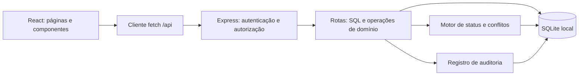

# Folga Manager — arquitetura atual e diagnóstico inicial

Data: 10/10/2026.

## Escopo

Análise por leitura da documentação, configurações, inicialização, schema, rotas do backend, motor de regras, contratos da API, contextos do frontend, carregamentos e ações das telas e scripts de teste. Este documento descreve o código encontrado. Não confirma execução, conformidade jurídica ou o schema do banco existente.

Não foram executados build, migrations, seed, reset, servidor ou testes. Os testes existentes chamam um seed destrutivo no mesmo caminho de banco usado pela aplicação. O código funcional e o banco não foram alterados nesta análise.

## Produto e arquitetura

O Folga Manager apoia o cadastro de colaboradores, planejamento de folgas e acompanhamento de pendências de descanso. O fluxo principal é identificar pendências no dashboard, agendar individualmente ou em lote e acompanhar calendário, histórico e relatórios CSV.

O código já inclui login, administração de usuários e setores e perfis ADMIN, MANAGER e VIEWER. Gestores e visualizadores recebem escopo por setores. Não há entidade empresa ou chave de empresa: a estrutura atual representa uma organização com vários setores e usuários.

O projeto possui frontend e backend no mesmo pacote npm. O backend é um monólito dividido em rotas por recurso. SQL, validação, autorização e escrita estão concentrados nos handlers. O serviço de regras também consulta o banco diretamente. Não há camada separada de casos de uso ou repositórios.

| Área | Implementação | Arquivos centrais |
| --- | --- | --- |
| Interface | React 18, TypeScript, Tailwind, Lucide | src/main.tsx, src/App.tsx |
| Navegação | Estado currentPage, sem roteador por URL | src/App.tsx |
| Sessão | AuthContext, token Bearer e usuário em localStorage | src/context/AuthContext.tsx |
| Cliente API | fetch, erros e evento para 401 | src/services/api.ts |
| HTTP | Express, CORS e JSON | server/app.ts |
| Inicialização | Migrations antes de abrir a porta | server/index.ts |
| Persistência | node:sqlite, DatabaseSync, WAL e foreign keys | server/db/connection.ts |
| Regras | Status, intervalo de folgas e aviso de cobertura | server/services/dsrRules.ts |
| Segurança | requireAuth, requireRole, requireMutation e escopo | server/middlewares/auth.ts |
| Senhas | scrypt com salt e comparação em tempo constante | server/utils/auth.ts |

Em desenvolvimento, Vite atende na porta 5173 e encaminha /api ao Express na porta 3001. O caminho do banco depende de process.cwd(): ao iniciar na raiz, usa data/folga_manager.db.

O build executa TypeScript e Vite para gerar o frontend. Não há script start de produção, compilação dedicada do servidor ou entrega dos arquivos estáticos pelo Express. O proxy configurado é o de desenvolvimento.

## Modelo de dados declarado

O schema atual declara dez tabelas:

| Tabela | Responsabilidade |
| --- | --- |
| departments | Setores e estado ativo/inativo |
| users | Usuários, hash de senha e perfil |
| user_departments | Vínculos entre usuários e setores |
| user_sessions | Tokens e expiração |
| employees | Cadastro, contrato, jornada e estado do colaborador |
| days_off | Data, tipo e estado de folga |
| work_schedules | Data, turno e estado de escala |
| audit_logs | Eventos com usuário, colaborador e setor |
| settings | Configurações globais por chave |
| notifications | Notificações globais ou de setor |

Folgas e escalas têm unicidade por colaborador/data. Excluir um colaborador apaga suas folgas e escalas por cascade; a auditoria conserva o evento com vínculo de colaborador nulo. Setores são desativados logicamente.

O setor aparece como texto department e chave department_id. Parte das consultas usa o nome atual via JOIN e parte usa o texto do cadastro, inclusive a regra de cobertura operacional.

## Fluxos principais

1. Login valida email/senha, armazena token aleatório com sete dias de validade no banco e retorna usuário e setores. O cliente persiste sessão em localStorage.
2. requireAuth verifica token, expiração e usuário ativo; consulta setores ativos autorizados. ADMIN tem acesso global.
3. Colaboradores: listagem e detalhe respeitam escopo; criação/edição verificam também o setor de destino. VIEWER é bloqueado nas mutações de domínio.
4. Folga individual: verifica escopo e duplicidade, grava folga, sincroniza escala e registra auditoria.
5. Folga em lote: valida escopo antes de processar, insere itens e auditoria, retorna contagem e erros. Não sincroniza escala.
6. Dashboard: calcula status por colaborador e reúne grade semanal, próximas folgas e notificações. Colaborador ativo sem escala explícita nem folga é tratado como trabalhando no cálculo do dia.
7. Relatórios: resumo e CSV usam escopo. Exportações de folgas, pendências e auditoria usam ponto e vírgula e BOM UTF-8.

As telas usam estado local, fetch e eventos globais folga-updated/employee-updated. O layout consulta o dashboard a cada quinze segundos e as notificações a cada trinta segundos. A tela de calendário lê colaboradores e folgas, sem carregar work_schedules.

## Prioridades identificadas por leitura

### 1. Isolar banco de testes

server/db/seed.ts:26 apaga sessões, usuários, setores, colaboradores, folgas, escalas, auditoria, notificações e configurações. Os cinco scripts de teste chamam esse seed. A conexão não permite configurar um caminho separado por ambiente. Executar testes na raiz pode substituir os dados da aplicação por demonstração. O reset também chama o seed.

Próxima ação proposta: banco dedicado para testes e barreira explícita contra seed/reset fora do ambiente de demonstração antes de executar as suítes.

### 2. Garantir consistência entre folgas e escalas

server/routes/daysOff.ts:148 altera a data da folga sem mover a escala antiga nem criar a nova. Uma folga criada no dia A e movida para B pode deixar A como folga na escala. O lote em daysOff.ts:263 não sincroniza escala. server/routes/schedules.ts permite gravar trabalho quando há uma folga na mesma data.

Não foram encontrados BEGIN/COMMIT/ROLLBACK nas operações do backend. Folga, escala e auditoria são gravadas independentemente. Falhas intermediárias podem deixar operações parcialmente persistidas. O helper de auditoria captura a falha e continua.

Próxima ação proposta: definir a fonte de verdade do estado do dia e reunir as mutações relacionadas em caso de uso transacional compartilhado por criação, edição, exclusão e lote.

### 3. Validar e especificar o motor de alertas

server/services/dsrRules.ts:104 diferencia apenas 5x2 das demais escalas. O motor mede distância em dias desde/até folgas e não reconstrói uma sequência completa de jornadas. As consultas de descanso passado não distinguem planejada, confirmada e realizada.

Exemplo da lógica atual: última folga há oito dias e próxima amanhã resulta em proxima, porque essa condição vem antes da avaliação de intervalo longo. A configuração clt_alert_days é salva e exibida, mas o motor não a lê. Não há horários de início/fim no schema para intervalos em horas nem regra específica de revezamento de domingos no serviço analisado.

Próxima ação proposta: definir requisitos por regime e casos temporais com o responsável pelo domínio; tornar o cálculo determinístico e independente do banco. As referências jurídicas da documentação precisam de validação especializada. Esta análise avalia somente a implementação.

### 4. Corrigir escopo e definir leitura de notificações

server/routes/notifications.ts:51 marca uma notificação por ID sem verificar se pertence ao escopo do usuário autenticado. is_read é compartilhado: a leitura de um usuário altera a visualização dos demais.

A geração de notificações encontrada está no seed. As pendências do dashboard são dinâmicas, mas não foi encontrado produtor de notificações operacionais que acompanhe suas mudanças.

Próxima ação proposta: autorizar a mutação individual por escopo e definir se a leitura é pessoal ou compartilhada pelo setor.

### 5. Fortalecer migrations e identidade de setores

server/db/migrate.ts usa criação condicional e alterações de colunas, sem histórico de versões. Erros incrementais são capturados e a execução continua até a mensagem de sucesso. A migração legada atribui department_id = 1 sem mapear o nome original de cada setor.

As constraints do banco novo não são todas adicionadas pelo caminho incremental. A duplicidade de nome e ID permite divergências após renomear setores.

Próxima ação proposta: migrations versionadas, falha explícita e reconciliação dos setores a partir dos dados existentes, com validação de integridade.

### 6. Estabilizar atualização e navegação do frontend

src/context/ToastContext.tsx:44 fornece novo objeto de contexto a cada render. Páginas dependem desse objeto em callbacks que disparam carregamentos. Adicionar/remover toast pode causar consultas extras; erros persistentes podem repetir consultas e toasts.

src/components/command/CommandPalette.tsx:138 envia ID do colaborador como parâmetro de navegação; App.tsx descarta esse parâmetro e não fornece initialSelectedId a EmployeesPage.

SchedulePage carrega apenas o mês de currentDate, embora exiba dias de meses vizinhos; folgas desses dias não são carregadas. Datas misturam formatação local e toISOString(), com possibilidade de mudança de dia perto da meia-noite.

Próxima ação proposta: estabilizar contexto, explicitar parâmetros de navegação e padronizar datas e intervalos de consulta.

## Direção inicial de evolução

Manter inicialmente o monólito e fortalecer os limites internos gradualmente:

- Rotas HTTP: validação de entrada, autenticação, autorização e resposta.
- Casos de uso: cadastro e planejamento com transações e auditoria.
- Domínio: jornada, descanso e conflitos com entradas explícitas.
- Persistência: consultas parametrizadas com escopo consistente.
- Frontend: contratos tipados e carregamentos previsíveis.

Sequência proposta: proteger banco nos testes, corrigir autorização de notificações, consistência folga/escala e cálculo de alertas. Depois tratar migrations, estabilidade do frontend e processo de produção. Banco e infraestrutura devem ser escolhidos conforme volume, concorrência, hospedagem e necessidade de várias empresas.

## Decisões de produto confirmadas

- **Empresas:** atender uma única empresa nesta etapa. O produto deverá evoluir para várias empresas independentes no futuro. A evolução precisa prever isolamento de dados entre empresas; a implementação dessa separação ainda não foi definida.
- **Dados:** todos os dados atuais são mockados. Ainda não há cópias de segurança. Essa decisão descreve o ambiente atual; a política de backup para dados reais permanece pendente.
- **Descanso realizado:** confiar nas informações fornecidas pelas pessoas. Não foi solicitado controle de ponto nem comprovação automática. O comportamento de planejada/confirmada/realizada ainda precisa ser detalhado antes de alterar o cálculo.
- **Concorrência:** até cinco usuários simultâneos no momento. A quantidade de colaboradores ainda não foi informada.
- **Hospedagem:** não decidida. Render ou frontend na Vercel com PostgreSQL em Docker são alternativas mencionadas pelo usuário, sem escolha aprovada de infraestrutura ou migração de banco.
- **Notificações:** leitura pessoal. Marcar como lida deve afetar somente o usuário que realizou a ação, preservando a autorização por setor. O campo global notifications.is_read não atende esse requisito; será necessário representar a leitura por usuário.

- **Escalas:** maioria em 6x1 e parte em 3x4. No 3x4, os dias de trabalho tendem a se repetir semanalmente e variam por empregado. Representar os dias habituais de cada empregado e permitir ajustes pontuais. Horários ainda não definidos. Freelancers são uma categoria separada, sem equiparação automática a PJ ou aplicação automática da mesma política de alertas.
- **Regras adicionais:** no momento não há regra específica da empresa ou acordo da categoria informado. Isso não define nem valida regras legais aplicáveis.
- **Cobertura:** não há mínimo de pessoas por setor ou turno definido. O aviso atual de mais de 50% do setor de folga é uma política embutida no código, não um requisito confirmado. Não deve ser tratado como restrição obrigatória; sua remoção ou configuração será uma alteração futura.
- **Freelancers no calendário:** exibir preferencialmente apenas nos dias em que forem chamados. Sem convocação, não contar como trabalhando nem gerar automaticamente pendência de folga. Revisar a inferência atual de trabalho quando não existe escala explícita.

## Questões de produto ainda abertas

- Quantos colaboradores são esperados nesta etapa?
- Como será registrada a informação de descanso realizado, confiando nas pessoas?
- Onde frontend, API e banco serão executados em produção, e como serão feitos os backups de dados reais?

## Documentação e limites

O README descreve seis tabelas e não apresenta integralmente autenticação e controle de acesso. multi-user-access-control.md mantém tarefas desmarcadas apesar de rotas, middlewares, telas e scripts correspondentes existirem. Os relatos históricos de aprovação de testes não foram reproduzidos nesta análise.

Este documento é a base inicial para decisões futuras e deve acompanhar a evolução dos requisitos e da implementação.

